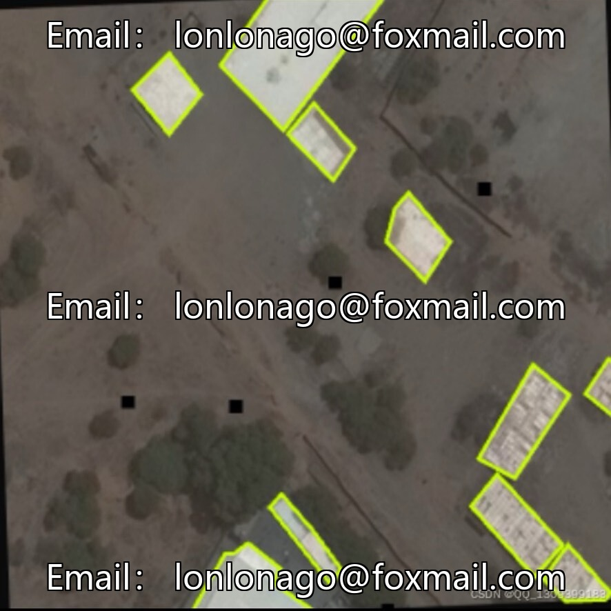
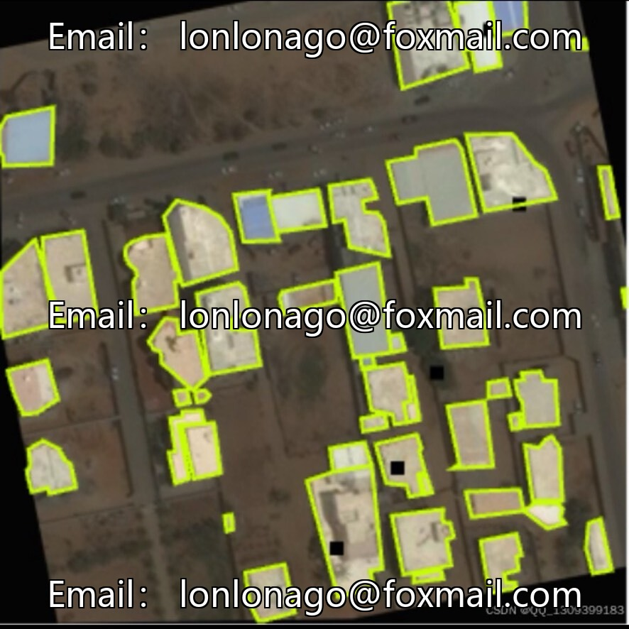
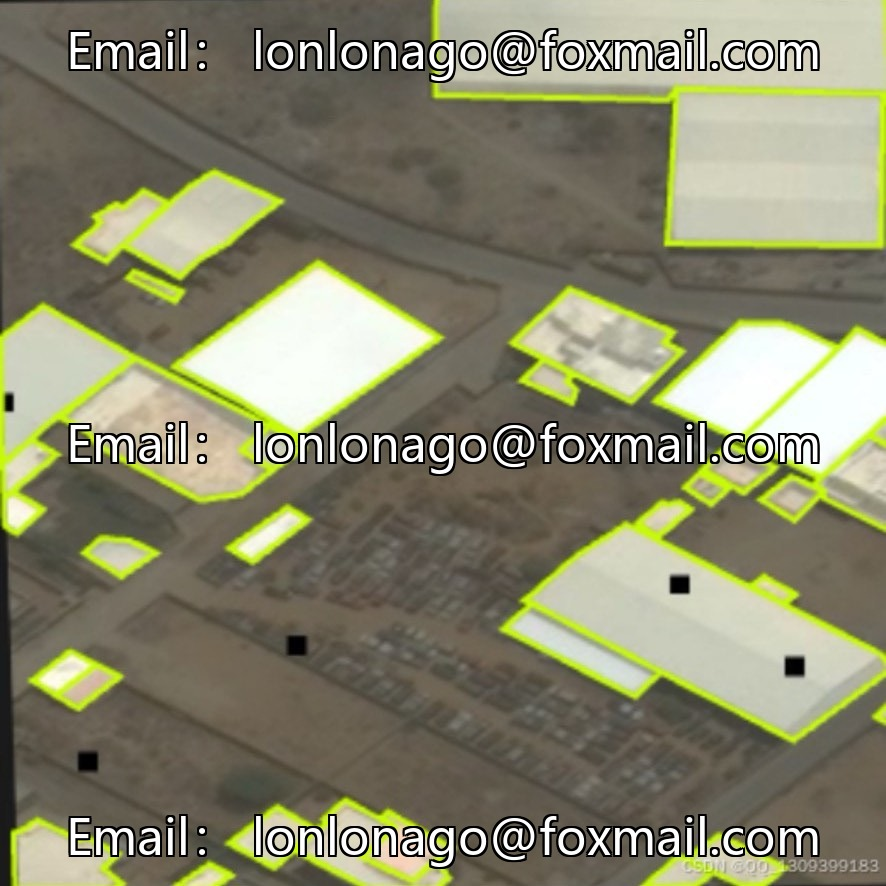
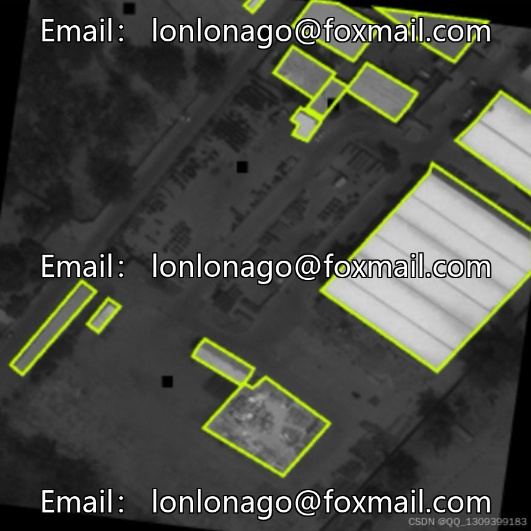

# UAV aerial photography of illegal constructions dataset example segmentation, issue 10014, applicable to urban areas

## Body

UAV aerial photography of illegal constructions dataset example segmentation, 10014th issue, applicable for model training and research related to urban inspection and illegal construction investigation.

The dataset consists of 8,592 images, medium-sized, with pixel-level mask annotations, precisely delineating the boundaries of illegal constructions. It contains only one class of target, and the names of the illegal construction objects are not yet disclosed. The distribution of the data is unknown, and some images have been enhanced. The estimated resolution ranges from 512×512 to 1024×1024, balancing segmentation accuracy and computational cost. It is primarily applied in areas such as unmanned aerial vehicle (UAV) aerial photography of illegal buildings, urban intelligent inspection, remote sensing image segmentation, etc.

Virtual materials, once sold, are non-refundable.
Interested friends, click "I want" to proceed.

## Images

## Payment

Here is a pay link on Stripe ( https://buy.stripe.com/3cs8yP7sY87d0vu9AB ). Please contact me lonlonago@foxmail.com after funding $89, and I will send you a complete data files , thank you!

